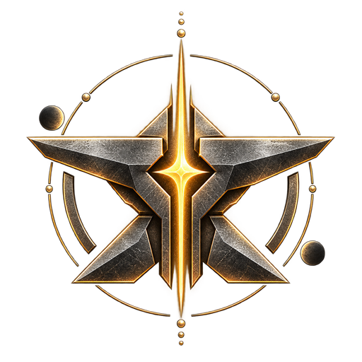

  

<h1 align="center">ANViL-D2</h1>

Server emulator for the D2 build 244019 game client

  
  
  

  <a href="#status"><b>Status</b></a> &nbsp;&middot;&nbsp;
  <a href="#requirements"><b>Requirements</b></a> &nbsp;&middot;&nbsp;
  <a href="#install--update"><b>Install</b></a> &nbsp;&middot;&nbsp;
  <a href="#patch-notes"><b>Patch notes</b></a> &nbsp;&middot;&nbsp;
  <a href="docs/README.md"><b>Commands</b></a> &nbsp;&middot;&nbsp;
  <a href="#releases"><b>Releases</b></a>

 

**ANViL** is a server emulator for the **D2 build 244019** game client.
Play it **offline** on your own PC, or host a server and **play with friends**.
This repository hosts the files players need on their own PC to connect to an ANViL server.

> [!WARNING]
> **Early and experimental.** ANViL is at a very early stage and does not run the full game yet. Expect bugs, and
> expect many things to be missing or broken.

## Status

Only the areas listed here work, and only as far as their state says.

   confirmed working in play &nbsp;
   you can play it; known bugs or gaps &nbsp;
   added, not yet confirmed; may not work &nbsp;
   not usable yet &nbsp;
   not in ANViL yet

<table>
<tr>
<td valign="top">

<table>
<tr><th align="left">Game</th><th align="left">State</th></tr>
<tr><td>Sign-in and characters</td><td></td></tr>
<tr><td>The Tower</td><td></td></tr>
<tr><td>Fireteams with friends</td><td></td></tr>
<tr><td>Story missions</td><td></td></tr>
<tr><td>Strikes</td><td></td></tr>
<tr><td>Patrols: Cosmodrome and EDZ</td><td></td></tr>
<tr><td>Public events</td><td></td></tr>
<tr><td>Seasonal Hub weekly reward track</td><td></td></tr>
<tr><td>Expansion campaigns</td><td></td></tr>
<tr><td>Dungeons</td><td></td></tr>
<tr><td>Raids</td><td></td></tr>
<tr><td>Crucible (PvP)</td><td></td></tr>
<tr><td>Gambit</td><td></td></tr>
</table>

</td>
<td valign="top">

<table>
<tr><th align="left">Systems and tools</th><th align="left">State</th></tr>
<tr><td>Vendors, bounties and loot</td><td></td></tr>
<tr><td>Gear and stats</td><td></td></tr>
<tr><td>Infusion cost</td><td></td></tr>
<tr><td>Triumphs</td><td></td></tr>
<tr><td>Clans</td><td></td></tr>
<tr><td>Character appearance</td><td></td></tr>
<tr><td>Loadouts</td><td></td></tr>
<tr><td>Buffs and consumables</td><td></td></tr>
<tr><td>Staff roles and moderation</td><td></td></tr>
<tr><td>Server management window</td><td></td></tr>
<tr><td>In-game overlay</td><td></td></tr>
<tr><td>In-game console</td><td></td></tr>
</table>

</td>
</tr>
</table>

## What a release contains

| File | Purpose |
|---|---|
| `steam_api64.dll` | The ANViL client DLL. It connects the game to an ANViL server instead of the official services. |
| `Launcher.exe` | The ANViL launcher (only in releases where it changed): sign-in, server address, updates. |
| `SHA256SUMS.txt` | SHA-256 checksums of every file in the release. |
| `release.json` / `release.json.sig` | The release manifest (version, file checksums) and its signature. |

## Requirements

- A Windows PC. The launcher and the client DLL are Windows only.
- The D2 game client, **build 244019** exactly. Other builds are not supported.
- An ANViL server to connect to, run by you or by a friend.
- The client DLL must come from the **same release as the server**. A mismatched pair may fail to connect.

## Install / update

> [!NOTE]
> No release is published yet, and there is no date for the first one.

**With the ANViL launcher (recommended).** When you sign in to a friend's server, the launcher checks which release
that server runs, downloads it from this repository, verifies its signature and checksums, backs up your current DLL
and installs the matching one. The launcher updates itself the same way. If an update cannot be verified, nothing is
replaced, and you can choose to play anyway or cancel.

<b>By hand</b>

 

1. Ask the server owner which release they run (versions look like `v0.2.0`).
2. Download that release's files.
3. Check them against `SHA256SUMS.txt`.
4. Copy `steam_api64.dll` into the game's `bin\x64` folder (back up the old one first).
5. Start the game through the ANViL launcher and sign in to the server.

## Patch notes

Every release comes with patch notes. You can read them:

- on the release's page in this repository;
- in the launcher's **Patch Notes** panel, newest version first. A NEW tag marks versions you have not seen yet, and
  the last downloaded notes stay readable offline;
- in game, in the **What's New** tab, where the server posts each new release's notes once;
- in game, as a popup at character select, if the server turns it on. It shows each release's notes once per
  account. A new account first gets a short welcome message.

## Commands

The server is run and configured with chat, console and command-line commands. The
**[command reference](docs/README.md)** covers:

- where to type commands, and the admin and player roles;
- clans: creating, joining and managing them with `!clan`;
- items, currency, missions, quests and progression, including the vendor ranks and the Seasonal Hub weekly track;
- world pickups, public events, seasonal events and inbox announcements;
- the server window, and reloading the settings files while the server runs;
- every server setting (loot, chests, Power, dismantling, vault size, XP, reputation, the Tower, resets, Xur) and
  every command-line flag.

## Releases

Versions follow `vMAJOR.MINOR.PATCH`: the last number goes up for fixes, the middle one for new features. Each
release is built from a fully validated server and client pair. Use the newest release unless your server owner says
otherwise.

## Credits and license

ANViL started from [Dawn](https://github.com/isinternets/Dawn) by isinternets and the Dawn contributors, which builds
on the Sunrise and Sundial projects as credited there. ANViL is licensed under the GNU General Public License,
version 3 only (GPL-3.0-only), and comes with no warranty.
